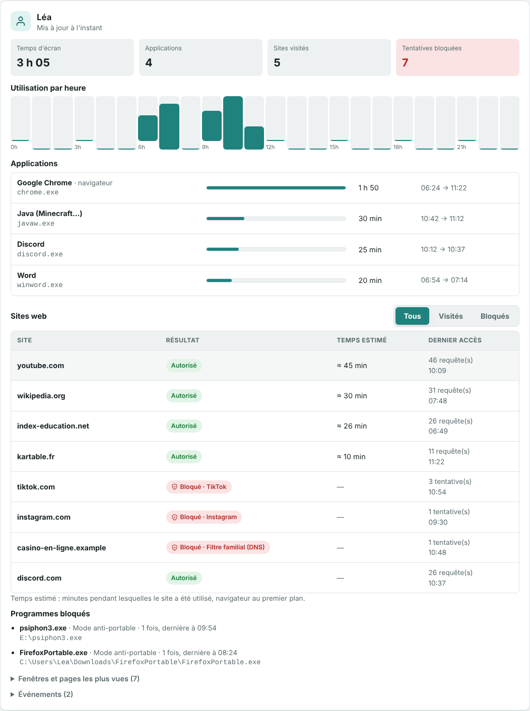
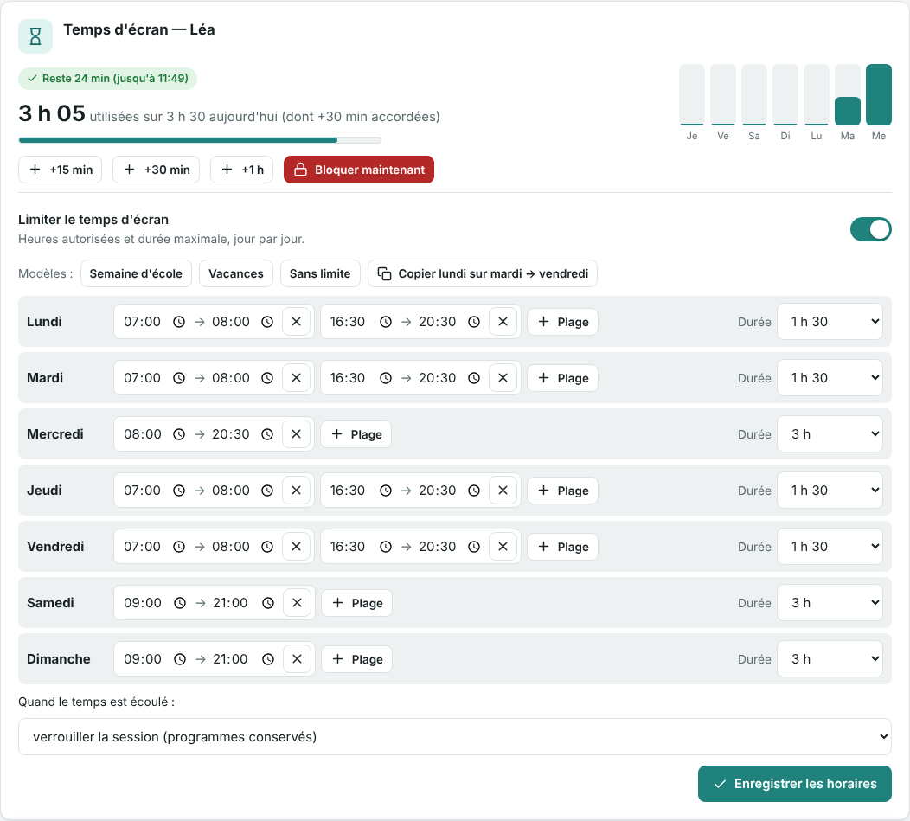

<div align="center">


# HOTS Hosts — Web administré

**Le contrôle parental et les protections de vos PC Windows, pilotés à 100 % à distance depuis une console web.**

Pour les familles et les établissements scolaires : chaque client (famille, école) a son propre
espace sur la console et ne voit que ses PC.

[](LICENSE.txt)
[](#2-installer-sur-chaque-pc-à-protéger)
[](#1-installer-la-console-une-seule-fois)
[](https://github.com/jrsmrtn/HOTS-Web-Administrated/actions/workflows/ci.yml)

| 💻 PC à protéger (Windows) | 🌐 Console web (serveur) | 📖 Guide complet |
|---|---|---|
| [**HOTS_Hosts_setup.exe**](https://github.com/jrsmrtn/HOTS-Web-Administrated/releases/latest/download/HOTS_Hosts_setup.exe) | [**HOTS_Console_Server.zip**](https://github.com/jrsmrtn/HOTS-Web-Administrated/releases/latest/download/HOTS_Console_Server.zip) | [docs/CONSOLE_WEB.md](docs/CONSOLE_WEB.md) |

Toutes les versions : [page Releases](https://github.com/jrsmrtn/HOTS-Web-Administrated/releases)

</div>

> [!NOTE]
> **Version de test.** La console, le serveur et l'agent sont testés automatiquement à chaque
> modification, mais les protections avancées (DNS verrouillé, mode anti-portable, réseaux de
> confiance…) doivent encore être validées sur de vrais PC Windows : la liste des vérifications
> est dans [docs/AUDIT_CONTROLE_PARENTAL.md](docs/AUDIT_CONTROLE_PARENTAL.md). Essayez d'abord sur
> un PC de test.

---

## Ce que ça fait

- 🌐 **Console web** (ordinateur ou téléphone) : vous changez un réglage, le PC l'applique en
  environ une seconde, ou dès qu'il se rallume s'il est éteint.
- 👨‍👩‍👧 **Plusieurs clients sur un même serveur** : chaque famille ou établissement a son compte,
  ses utilisateurs et ses PC, sans voir ceux des autres.
- 🛡️ **Contrôle parental** : 15 catégories à bloquer en un clic (réseaux sociaux, adulte, jeux,
  rencontres…), filtre DNS familial Cloudflare, blocage d'applications et de VPN, coupure
  d'Internet, mode absence.
- 🔒 **Difficile à contourner**, même par un ado débrouillard :
  - **bilan de sécurité** noté sur 100 avec les corrections à faire en priorité (compte enfant
    administrateur, DNS modifié, navigateur portable trouvé…), et réparation automatique ;
  - **navigateurs verrouillés** (Chrome, Edge, Firefox, Brave…) : pas de DNS chiffré, pas de
    proxy, extensions sur liste blanche, navigation privée désactivée pour les enfants ;
  - **DNS verrouillé** sur toutes les cartes réseau, IPv4 et IPv6 ;
  - **mode anti-portable** : le compte enfant ne lance que les programmes installés ou approuvés
    (un navigateur copié sur une clé USB ne démarre pas) ;
  - **SafeSearch** Google et Bing et mode restreint YouTube partout ;
  - **alertes** (PC hors ligne, Windows réinstallé, protection retirée, nouveau compte
    administrateur…), aussi par e-mail.
- ⏱️ **Temps d'écran** pour chaque enfant : heures autorisées et durée maximale jour par jour,
  avertissements 10, 5 et 1 minute avant la fin puis verrouillage de la session, « +30 min » ou
  « Bloquer maintenant » à distance. Les règles s'appliquent même sans Internet.
- 📊 **Journal d'activité** : applications utilisées et durée, sites visités (temps estimé) ou
  bloqués (par quelle liste), programmes bloqués, utilisation heure par heure. Jamais pour les
  comptes des parents.
- 🏫 **Pensé pour l'école** : sur les **réseaux de confiance** (Wi-Fi de l'établissement), le PC
  utilise le DNS et le proxy de l'établissement. Sur un **Wi-Fi public** (gare, hôtel), une fenêtre
  de 10 minutes permet de passer la page de connexion. Un élève reste donc connecté partout.
- 🕵️ **Confidentialité Windows** et **éditeur du fichier hosts** : toutes les fonctions de
  l'application d'origine restent disponibles sur le PC.

<table>
<tr>
<td width="50%" valign="top"><br/><sub>Activité d'un enfant : applications, sites visités ou bloqués, temps passé</sub></td>
<td width="50%" valign="top"><br/><sub>Temps d'écran : plages horaires, durée par jour, temps en plus ou blocage à distance</sub></td>
</tr>
</table>

Le PC n'ouvre **aucun port** : c'est lui qui contacte la console en HTTPS, ce qui fonctionne
derrière n'importe quelle box ou réseau d'établissement. Il n'exécute qu'une **liste fermée
d'actions** (aucune commande libre), et chaque action est inscrite dans le journal.

---

## Démarrage rapide

### 1. Installer la console (une seule fois)

Choisissez selon votre serveur. Le guide détaille chaque étape :
[docs/CONSOLE_WEB.md](docs/CONSOLE_WEB.md#1-installer-le-serveur-10-minutes).

<table>
<tr><th>VPS / serveur Ubuntu (accès root)</th><th>Hébergement mutualisé / Virtualmin (sans root)</th></tr>
<tr><td valign="top">

Assistant graphique, HTTPS automatique (Caddy), sauvegardes quotidiennes, mises à jour en un
clic.

```bash
wget https://github.com/jrsmrtn/HOTS-Web-Administrated/releases/latest/download/HOTS_Console_Server.zip
unzip HOTS_Console_Server.zip && cd HOTS_Console_Server
sudo ./deploy.sh
```

Sans nom de domaine, une adresse `….sslip.io` est créée pour vous.

</td><td valign="top">

Pas de `sudo` ni d'`apt` : tout s'installe dans `~/hots-console`. Un domaine ou sous-domaine dédié
avec HTTPS (Let's Encrypt du panneau) suffit.

```bash
unzip HOTS_Console_Server.zip && cd HOTS_Console_Server
bash install-mutualise.sh
```

Le script écrit le `.htaccess` qui relaie le domaine vers la console, et ajoute à votre crontab le
démarrage automatique, la surveillance et la sauvegarde.

</td></tr>
</table>

À la fin, un **lien** s'affiche : ouvrez-le pour créer le compte administrateur.
Ensuite, les **mises à jour se font en un clic** depuis la page Administration de la console.

### 2. Installer sur chaque PC à protéger

Dans la console : **Mes PC → Ajouter un PC**. Vous obtenez un **code** (ex. `P7QF-PA2Z`). Sur le PC,
lancez **HOTS_Hosts_setup.exe** et saisissez l'adresse de la console et ce code à l'étape
« Administration à distance ». C'est tout : le PC apparaît dans la console.

Pour un parc (informaticiens), l'installation peut se faire sans questions :

```bat
HOTS_Hosts_setup.exe /VERYSILENT /SERVER=https://console.mondomaine.fr /CODE=P7QF-PA2Z
```

### 3. Régler la protection

Dans la console, ouvrez le PC, onglet **Sécurité** : indiquez le compte Windows de l'enfant puis
suivez la liste « À faire en priorité ». Le compte enfant doit être un **compte standard**, et un
compte administrateur protégé par mot de passe doit rester sur le PC (la console sait faire les
deux).

<details>
<summary><strong>Windows affiche « Windows a protégé votre ordinateur » ?</strong></summary>

L'installateur n'est pas signé avec un certificat payant. Windows avertit donc pour toute
application récente : cliquez sur **Informations complémentaires → Exécuter quand même**. Le code
source complet est dans ce dépôt, et chaque release publie les empreintes `SHA256SUMS.txt` des
fichiers, que vous pouvez comparer. Détails : [CODE_SIGNING.md](CODE_SIGNING.md).
</details>

---

## Bon à savoir

- Le filtrage agit **sur ce PC Windows** : téléphones et tablettes ne sont pas couverts.
- Aucune liste de blocage n'est complète à 100 % : les grandes plateformes changent souvent de
  domaines. Le filtre DNS familial complète les listes, et vous pouvez ajouter vos propres domaines.
- Un enfant **administrateur** de son PC peut tout défaire : la console le signale en premier.
- Établissements : informez les élèves et leurs familles du contrôle mis en place (RGPD).

---

## Documentation

| Document | Contenu |
|---|---|
| [docs/CONSOLE_WEB.md](docs/CONSOLE_WEB.md) | Guide complet : installation (VPS ou mutualisé), ajout des PC, utilisation, plusieurs clients, mises à jour, sécurité, dépannage |
| [docs/AUDIT_CONTROLE_PARENTAL.md](docs/AUDIT_CONTROLE_PARENTAL.md) | Audit des contournements possibles, mesures mises en place, tests restant à faire sur Windows |
| [server/README.md](server/README.md) | Serveur de la console pour les développeurs |
| [SECURITY.md](SECURITY.md) | Signaler une faille de sécurité |

---

## Développement

<details>
<summary>Lancer depuis les sources, tests, publication d'une version</summary>

**Application Windows** (Python 3.10+, à lancer en administrateur) :

```bash
pip install -r requirements.txt
pythonw hosts_editor_launcher.pyw
```

**Console web** (Linux, macOS ou Windows) avec un PC de démonstration simulé :

```bash
cd server
pip install -r requirements.txt pytest httpx
python -m pytest -q
python -m hots_server serve --port 8080
python tools/demo_agent.py --server http://127.0.0.1:8080 --code CODE-AJOUT
```

**Arborescence**

```
hosts_editor/            application Windows (PySide6) et protections
hosts_editor/remote/     agent d'administration à distance (service SYSTEM, liste fermée d'actions)
server/hots_server/      console web : API Starlette + SQLite, interface en JavaScript sans framework
server/deploy/           deploy.sh (VPS Ubuntu) et install-mutualise.sh (hébergement sans root)
setup.iss                installateur Inno Setup
.github/workflows/       CI (tests, ShellCheck) et publication des versions
```

**Publier une version** : mettez le même numéro dans `hosts_editor/version.py` et `setup.iss`, puis
poussez un tag `vX.Y.Z`, ou un commit dont le message contient `[release]`. GitHub Actions construit
l'installateur Windows (Nuitka + Inno Setup) et le zip du serveur, puis publie la release.
</details>

---

## Crédits et licence

Ce projet est un fork de **[HOTS Hosts](https://github.com/darsono6/HOTS)** de Darsono
([hotstools.com](https://hotstools.com)), qui fournit l'application Windows : contrôle parental,
confidentialité, éditeur du fichier hosts, 8 langues. Si l'application vous rend service, vous
pouvez soutenir son auteur sur [ko-fi.com/darsono](https://ko-fi.com/darsono).

Ce fork ajoute la console web multi-clients, l'agent d'administration à distance et les
protections contre les contournements.

Composants tiers : [PySide6](https://doc.qt.io/qtforpython-6/) (LGPLv3/GPLv3),
[certifi](https://github.com/certifi/python-certifi) (MPL 2.0),
[Starlette](https://www.starlette.io/) et [Uvicorn](https://www.uvicorn.org/) (BSD),
[Fluent UI System Icons](https://github.com/microsoft/fluentui-system-icons) (MIT).

Fourni **sans aucune garantie** : vous l'utilisez à vos risques. Bugs et suggestions :
[issues du fork](https://github.com/jrsmrtn/HOTS-Web-Administrated/issues).

Licence [GNU GPL v3.0](LICENSE.txt) — © 2026 Darsono et contributeurs du fork.
