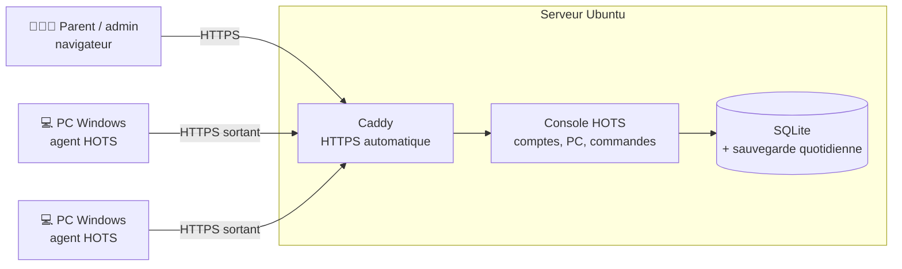

# Console web — administration 100 % à distance de HOTS Hosts

Ce fork ajoute à HOTS Hosts une **console web** : depuis un navigateur (ordinateur ou téléphone),
vous pilotez à distance tous les réglages des PC Windows protégés — contrôle parental, blocages,
confidentialité, fichier hosts — sans jamais vous asseoir devant eux.

Un même serveur accueille **plusieurs clients** (familles, écoles, entreprises…) : chacun a son
compte, ne voit **que ses propres PC** et les administre indépendamment des autres.



- Les PC se connectent **vers** le serveur (connexion sortante HTTPS) : aucun port à ouvrir chez
  vous, ça marche derrière n'importe quelle box, en 4G, à l'école…
- Une modification faite dans la console est appliquée sur le PC en **1 seconde environ**.
- Si le PC est éteint, la modification est **mise en file d'attente** et appliquée à son retour.

---

## Sommaire

1. [Installer le serveur (10 minutes)](#1-installer-le-serveur-10-minutes) — VPS Ubuntu, ou [hébergement mutualisé / Virtualmin sans root](#variante--hébergement-mutualisé-ou-serveur-virtuel-virtualmin-sans-root)
2. [Premier lancement : créer le compte administrateur](#2-premier-lancement--créer-le-compte-administrateur)
3. [Ajouter un PC](#3-ajouter-un-pc)
4. [Utiliser la console](#4-utiliser-la-console)
5. [Plusieurs clients sur le même serveur](#5-plusieurs-clients-sur-le-même-serveur)
6. [Mises à jour, sauvegardes, désinstallation](#6-mises-à-jour-sauvegardes-désinstallation)
7. [Sécurité : comment c'est protégé](#7-sécurité--comment-cest-protégé)
8. [Dépannage](#8-dépannage)
9. [Publier une nouvelle version (mainteneur)](#9-publier-une-nouvelle-version-mainteneur)

---

## 1. Installer le serveur (10 minutes)

### Ce qu'il faut

| | |
|---|---|
| **Un serveur Ubuntu** 22.04 ou 24.04 (Debian 12 fonctionne aussi) | Un petit VPS suffit (1 vCPU, 1 Go de RAM) : OVH, Scaleway, Hetzner, IONOS… comptez 4 à 6 €/mois. |
| **Ports 80 et 443 ouverts** | Dans le pare-feu de l'hébergeur si vous en avez un (le script ouvre ceux du serveur). |
| **Un nom de domaine** *(facultatif)* | Ex. `console.mondomaine.fr`, avec un enregistrement DNS **A** vers l'IP du serveur. Sans domaine, le script crée automatiquement une adresse gratuite du type `51-15-20-30.sslip.io`. |

> 💡 Si votre domaine passe par Cloudflare, laissez le nuage **gris** (pas de proxy) pour
> l'enregistrement de la console : le HTTPS est géré par le serveur, et la fonction « Couper
> Internet » a besoin de connaître l'adresse IP réelle de la console (voir [§7](#7-sécurité--comment-cest-protégé)).

### Installation

1. Téléchargez **`HOTS_Console_Server.zip`** depuis la page
   [Releases](https://github.com/jrsmrtn/HOTS-Web-Administrated/releases/latest).
2. Copiez-le sur le serveur et lancez l'assistant :

```bash
wget https://github.com/jrsmrtn/HOTS-Web-Administrated/releases/latest/download/HOTS_Console_Server.zip
```

```bash
sudo apt install -y unzip && unzip HOTS_Console_Server.zip && cd HOTS_Console_Server
```

```bash
sudo ./deploy.sh
```

3. Laissez-vous guider : l'assistant s'affiche en **fenêtres** dans le terminal (flèches + Entrée).
   Il vous demande seulement l'adresse de la console (votre domaine, ou adresse automatique) et,
   facultativement, un e-mail pour Let's Encrypt. Il installe ensuite tout seul :
   - l'application et son environnement Python isolé (`/opt/hots-console`) ;
   - le service `hots-console` (redémarrage automatique, protections systemd) ;
   - **Caddy**, qui obtient et renouvelle le certificat **HTTPS** automatiquement ;
   - une **sauvegarde quotidienne** de la base (`/var/backups/hots-console`, 14 jours).

4. À la fin, un **lien** (et un QR code) s'affiche : c'est l'étape suivante.

<details>
<summary><strong>Installation sans questions (automatisation)</strong></summary>

```bash
sudo ./deploy.sh --domain console.mondomaine.fr --email moi@mondomaine.fr --yes
```

```bash
sudo ./deploy.sh --sslip --yes
```

Le lien de configuration est affiché à la fin, et à tout moment avec `sudo hots-server setup-link`.
</details>

### Variante : hébergement mutualisé ou serveur virtuel Virtualmin (sans root)

Vous n'avez pas d'accès `sudo` ni `apt`, seulement un compte d'hébergement (serveur virtuel
Virtualmin/Webmin, ou un hébergement mutualisé avec accès SSH) : utilisez
**`install-mutualise.sh`**, inclus dans le même zip. Tout s'installe dans `~/hots-console` et
fonctionne avec votre propre utilisateur.

| Il faut | Détail |
|---|---|
| Un accès **SSH** (ou le terminal du panneau) | Webmin : **Outils → Ligne de commande / Terminal**. |
| Un domaine ou sous-domaine **dédié** à la console | Ex. `console.mondomaine.fr`, créé comme serveur virtuel (ou sous-serveur) avec son site web. Tout le site est relayé vers la console. |
| **Python 3.11+** | Déjà présent sur Debian 12, Ubuntu 24.04, AlmaLinux 10… Sinon le script télécharge un Python privé (≈ 30 Mo) dans `~/hots-console`, si le serveur peut accéder à Internet. |
| Apache avec les modules **proxy** et **proxy_http** | Activés par défaut avec Virtualmin. Sinon : relais configuré dans le panneau (voir plus bas). |
| Des **processus permanents** autorisés | La console tourne en continu (comme un petit service). Certains mutualisés bas de gamme l'interdisent. |

1. Dans Virtualmin, créez le serveur virtuel (ou sous-serveur) `console.mondomaine.fr` avec son
   site web, puis activez **HTTPS** : **Paramètres du serveur → Certificat SSL → Let's Encrypt**.
2. Envoyez `HOTS_Console_Server.zip` dans votre dossier personnel (SSH, SFTP ou le gestionnaire
   de fichiers), puis dans le terminal :

```bash
unzip HOTS_Console_Server.zip && cd HOTS_Console_Server
```

```bash
bash install-mutualise.sh
```

3. Le script demande l'adresse de la console et le dossier web du domaine (il les devine le plus
   souvent : appuyez sur Entrée). Il installe ensuite :
   - l'application dans `~/hots-console` (bibliothèques incluses dans le zip : pas de `pip`) ;
   - un **`.htaccess`** dans le dossier web du domaine, qui relaie le site vers la console
     (l'ancien fichier est gardé sous `.htaccess.avant-hots`, le chemin `/.well-known/` reste
     libre pour le renouvellement Let's Encrypt) ;
   - dans votre **crontab** : démarrage au redémarrage du serveur, surveillance toutes les
     5 minutes (redémarre la console si elle s'arrête), sauvegarde quotidienne (14 jours).
4. À la fin, le **lien de création du compte administrateur** s'affiche : passez au §2.

Sans questions : `bash install-mutualise.sh --domain console.mondomaine.fr --yes`
(autres options : `--webroot DOSSIER`, `--port N`, `--no-htaccess`, `--no-cron`).

**Commandes ensuite** (`~/hots-console/hots …`) : `status`, `restart`, `logs`, `setup-link`,
`reset-password EMAIL`, `backup`, `uninstall`. **Mise à jour** : décompressez le nouveau zip et
relancez `bash install-mutualise.sh` (base, réglages et port conservés).

<details>
<summary><strong>Pas de .htaccess possible (Nginx, panneau différent) : relais manuel</strong></summary>

Lancez `bash install-mutualise.sh --no-htaccess` : le script affiche le port local de la console
(ex. `127.0.0.1:28417`). Dans le panneau, faites relayer **tout le site** vers
`http://127.0.0.1:28417/` : Virtualmin **Configuration Web → Chemins de proxy** (« Proxy Paths »,
selon la version « Website Redirects » ou « Proxy website »), chemin `/`. Gardez le certificat
Let's Encrypt actif sur le domaine.
</details>

> ⚠️ **Hébergement mutualisé et « Couper Internet »** : quand Internet est coupé sur un PC, la
> console reste joignable grâce à une exception pour son adresse IP. Sur un mutualisé, cette
> adresse est partagée avec les autres sites du serveur, qui restent donc joignables eux aussi.
> Le reste du contrôle parental n'est pas concerné. Pour un établissement, préférez un petit VPS
> avec `deploy.sh`.
>
> Avec des dizaines de PC, chaque PC garde une connexion ouverte en permanence vers la console :
> sur un mutualisé, au-delà d'une cinquantaine de PC, passez plutôt à un VPS.

---

## 2. Premier lancement : créer le compte administrateur

Ouvrez le lien affiché par `deploy.sh` (`https://votre-console/#/setup/…`). Un assistant en
3 étapes vous demande :

1. le **nom de la console** (ex. « Console famille Martin ») ;
2. **votre compte administrateur** (nom, e-mail, mot de passe d'au moins 10 caractères) ;
3. **comment vos clients obtiennent un compte** : créés par vous (recommandé) ou inscription libre.

> Ce lien ne fonctionne qu'une fois : sans lui, personne d'autre ne peut prendre le contrôle de
> votre serveur entre son installation et votre première connexion.

---

## 3. Ajouter un PC

Dans la console : **Mes PC → Ajouter un PC**. Une fenêtre affiche l'adresse de la console et un
**code d'ajout** (ex. `P7QF-PA2Z`, valable 7 jours, utilisable pour plusieurs PC). Ensuite, sur
le PC à protéger :

### Nouvelle installation (le plus simple)

1. Téléchargez **`HOTS_Hosts_setup.exe`** (bouton « Télécharger l'installateur » de la fenêtre).
2. Lancez-le. À l'étape **« Administration à distance »**, collez l'**adresse** et le **code**.
3. Terminez l'installation : le PC apparaît dans la console en quelques secondes
   (la fenêtre de la console affiche « ✅ Nouveau PC détecté »).

### HOTS Hosts est déjà installé

Ouvrez HOTS Hosts → **Options → Administration à distance**, saisissez l'adresse et le code,
cliquez **Relier ce PC**. (Ou relancez simplement le nouvel installateur : il met à jour le
programme sans rien perdre et propose la même étape.)

### Déploiement sur plusieurs PC (informaticiens)

```bat
HOTS_Hosts_setup.exe /VERYSILENT /SERVER=https://console.mondomaine.fr /CODE=P7QF-PA2Z
```

### Ce qui est installé sur le PC

Un **agent** (`HOTS Remote Agent.exe`, dans le dossier du programme) démarré par une tâche
planifiée **au démarrage de Windows, en compte SYSTÈME** : il fonctionne même quand personne
n'est connecté, et un compte enfant (utilisateur standard) ne peut ni l'arrêter, ni lire ses
identifiants, ni le rediriger vers un autre serveur.

---

## 4. Utiliser la console

Le **tableau de bord** liste vos PC : en ligne / hors ligne, dernière connexion, et un résumé des
protections actives. Cliquez un PC pour l'administrer :

| Onglet | Ce que vous pouvez faire à distance |
|---|---|
| **Contrôle parental** | Bloquer 15 catégories (TikTok, YouTube, réseaux sociaux, adultes, jeux, rencontres…), filtre DNS familial Cloudflare, votre propre liste de sites bloqués. |
| **Temps d'écran** | Pour chaque compte enfant : heures autorisées et durée maximale, jour par jour (modèles « Semaine d'école », « Vacances »), **+15 min / +30 min / +1 h** pour aujourd'hui, **Bloquer maintenant** (30 min, 1 h, jusqu'à demain), temps utilisé aujourd'hui et sur 7 jours. |
| **Activité** | Pour chaque compte enfant et chaque jour : temps d'écran par heure, **applications** utilisées et durée, **sites web** visités (temps estimé) ou **bloqués** (par quelle liste), **programmes bloqués**, titres des fenêtres (facultatif), événements (temps écoulé, session verrouillée…). |
| **Sécurité** | **Score sur 100** et « 3 actions à faire » : compte enfant administrateur, protections annulées, navigateurs portables ou VPN trouvés dans les dossiers de l'enfant, extensions VPN, filtre DNS incomplet, UAC, Secure Boot, chiffrement… avec des boutons « Corriger ». Déclaration du ou des comptes enfants, passage en compte standard, auto-réparation. |
| **Protections** | Verrouiller le fichier hosts, **couper Internet** (la console reste joignable pour le rétablir), bloquer les VPN, bloquer la restauration du système, bloquer le « DNS sécurisé » de chaque navigateur, **navigateurs verrouillés** et **DNS verrouillé** (voir ci-dessous). |
| **Applications** | Bloquer n'importe quel programme, ou le choisir dans la liste des programmes installés ; suspendre / retirer un blocage. |
| **Confidentialité** | Les 4 niveaux de réglages anti-télémétrie de Windows, réglage par réglage ; vérifier que Windows ne les a pas annulés ; créer un point de restauration. |
| **Fichier hosts** | Tableau des entrées (recherche, ajout, modification, activation, suppression), édition en texte brut, sauvegardes et restauration. |
| **Outils** | Infos du PC (Windows, durée d'allumage…), renommer, notes, vider le cache DNS, retirer le PC de la console. |
| **Journal** | Historique de chaque action : qui, quand, résultat, durée. |

Bon à savoir :

- **PC hors ligne** : la console affiche son dernier état connu ; vos modifications sont
  programmées et s'appliquent dès son retour (bandeau « en attente »).
- **Fichier hosts verrouillé** : les modifications faites depuis la console le déverrouillent
  une fraction de seconde puis le reverrouillent automatiquement.
- Quelques réglages de confidentialité dépendent de la **session de l'utilisateur** (identifiant
  publicitaire, recherche Bing…) : ils s'affichent avec le badge « Session utilisateur » et se
  règlent dans l'application sur le PC.
- La console s'utilise aussi sur **téléphone**, et suit le thème clair/sombre de l'appareil.

### Temps d'écran et journal d'activité

Indiquez d'abord le **compte Windows de l'enfant** (onglet Sécurité). Les comptes des parents ne
sont jamais limités ni suivis.

**Temps d'écran** (onglet du même nom) :

- choisissez un modèle ou réglez chaque jour : une ou plusieurs **plages horaires** (ex.
  7 h–8 h et 16 h 30–20 h 30) et une **durée maximale** (ex. 1 h 30) ;
- le temps compte quand la session de l'enfant est ouverte et déverrouillée (pas après
  30 minutes sans clavier ni souris) ;
- l'enfant est prévenu **10, 5 puis 1 minute** avant la fin. À la fin, un message s'affiche et la
  session est **verrouillée une minute plus tard** (programmes conservés), ou fermée si vous le
  choisissez ;
- **+15 min / +30 min / +1 h** : du temps en plus pour aujourd'hui (en dehors des heures
  autorisées, cela ouvre une fenêtre de cette durée). **Bloquer maintenant** : 30 min, 1 h ou
  jusqu'à demain ;
- les règles sont gardées sur le PC et s'appliquent **même sans Internet**.

**Activité** (onglet du même nom) : activez « Enregistrer l'activité des enfants ». Ensuite, jour
par jour :

- **applications** au premier plan et durée d'utilisation ;
- **sites web** : visités (avec un **temps estimé** : minutes pendant lesquelles le site a servi,
  navigateur au premier plan) ou **bloqués**, avec la liste responsable (ex. « TikTok », « Filtre
  familial (DNS) ») et le nombre de tentatives ;
- **programmes bloqués** par le mode anti-portable ;
- titres des fenêtres et des pages (facultatif, ex. « Fortnite - YouTube ») et **événements**
  (temps écoulé, session verrouillée, suivi fermé par l'enfant).

Les données arrivent toutes les 5 minutes (bouton **Actualiser** pour les avoir tout de suite) et
sont gardées 90 jours sur la console, 31 jours sur le PC.

> Comment c'est mesuré : l'agent lance, dans la session de l'enfant et avec ses droits, un petit
> programme (« HOTS Remote Agent.exe ») qui note toutes les 5 secondes l'application au premier
> plan. S'il est fermé, l'agent le relance et le note dans les événements. Les sites viennent du
> journal « DNS Client » de Windows, que l'agent active ; Chrome, Edge et Brave sont réglés pour
> passer par le résolveur de Windows. **Établissements : informez les élèves et leurs familles de
> ce suivi (RGPD).**

### Renforcer la protection contre les contournements

Ces fonctions répondent à l'audit [AUDIT_CONTROLE_PARENTAL.md](AUDIT_CONTROLE_PARENTAL.md) (phase 1).

**Onglet Sécurité — le bilan.** Le PC fait un bilan toutes les 3 heures (bouton « Vérifier
maintenant » pour le relancer, environ 10 s). Commencez par cocher **« Compte enfant »** pour le ou
les comptes Windows de vos enfants : la console vérifie qu'ils ne sont pas administrateurs et
propose **« Rendre standard »**. Garde-fou : refusé s'il ne reste aucun autre compte administrateur
protégé par mot de passe. L'effet a lieu à la prochaine ouverture de session de l'enfant.
L'**auto-réparation** (activée par défaut) rétablit toutes les 30 minutes une protection annulée
(mise à jour Windows, manipulation) et le bilan la signale en rouge en attendant.

**Navigateurs verrouillés** (onglet Protections). Trois niveaux pour Chrome, Edge, Brave, Vivaldi,
Chromium et Firefox, y compris leurs copies portables ou installées dans le profil de l'enfant :

| Niveau | Effet |
|---|---|
| Standard | extensions VPN/proxy bloquées, proxy interdit, SafeSearch Google et Bing, YouTube restreint (modéré), mode invité désactivé, Tor et VPN de Brave désactivés, VPN intégré de Firefox désactivé |
| Strict | Standard + YouTube restreint strict + navigation privée désactivée (l'historique reste visible) |

Les navigateurs affichent alors « Géré par votre organisation », pour **tous** les comptes du PC.
Revenir à « Désactivé » restaure exactement les réglages d'avant. Opera, Opera GX et Tor Browser ne
suivent pas ces stratégies : le bilan les **repère** dans les dossiers de l'enfant et propose de les
bloquer.

**DNS verrouillé** (onglet Protections). Force le filtre familial Cloudflare sur **toutes** les
cartes réseau, en IPv4 et IPv6, y compris une carte qui apparaît plus tard (partage de connexion d'un
téléphone, autre Wi-Fi : couverte en 2 minutes maximum). Il bloque aussi les autres serveurs DNS et
les DNS chiffrés publics (Google, Cloudflare 1.1.1.1, Quad9, NextDNS, AdGuard…). À ne pas activer
sur un PC professionnel. Le Wi-Fi d'un hôtel ou d'un train peut ne plus afficher sa page de
connexion : désactivez le verrouillage avant un voyage. Désormais, la liste « adultes » du fichier
hosts **reste active** avec le filtre DNS : les deux protections se cumulent.

**Alertes.** Le tableau de bord et la page de chaque PC affichent les alertes :

- PC hors ligne depuis trop longtemps (délai réglable dans **Mon compte → Alertes**, 48 h par
  défaut) ;
- PC relié de nouveau ou nouveau PC portant le même nom (Windows réinstallé ?) ;
- HOTS Hosts désinstallé ;
- au moins 6 redémarrages en 24 h ;
- sécurité insuffisante (score < 60 ou problème grave).

Elles peuvent être envoyées **par e-mail**, une fois que l'administrateur du serveur a configuré
l'envoi (**Administration → Envoi d'e-mails**, avec un bouton d'e-mail de test). Vacances, PC rangé :
le **mode absence** (onglet Outils du PC) suspend les alertes « hors ligne » jusqu'à la date choisie.

### Établissements scolaires et Wi-Fi publics

Le filtre DNS familial et le **DNS verrouillé** empêcheraient de se connecter aux réseaux qui imposent
leur propre DNS : la page de connexion d'un hôtel, d'une gare ou d'un Wi-Fi invité, et la plupart des
réseaux d'établissement (filtrage obligatoire, noms internes de l'ENT, proxy).

- **Réseaux de confiance** (**Mon compte → Réseaux de confiance**, pour tous les PC du compte) : sur
  ces réseaux, le PC utilise le DNS et, si besoin, le **proxy** de l'établissement (détection
  automatique, fichier PAC ou proxy fixe). Les navigateurs verrouillés utilisent ce proxy et l'agent
  aussi. Le réseau est reconnu par le **nom du Wi-Fi ET l'adresse de sa passerelle** : un téléphone
  renommé comme le Wi-Fi du collège n'est pas reconnu. Un établissement client déclare son réseau une
  seule fois pour tous ses élèves.
- **Wi-Fi publics** : si le DNS filtré ne répond pas sur un réseau inconnu, le filtre est suspendu
  **10 minutes** sur ce réseau, le temps de passer la page de connexion. Il revient dès que la
  connexion est faite. Au plus 2 fenêtres par heure, et aucune nouvelle fenêtre pendant 1 heure si le
  réseau bloque toujours. Chaque fenêtre apparaît dans les alertes. Les listes de blocage, les
  navigateurs verrouillés et le blocage des DNS chiffrés restent actifs pendant la fenêtre.
- **Réseaux rencontrés** : les réseaux qui ont bloqué le filtre sont listés (sur le PC et dans Mon
  compte), avec un bouton **« Faire confiance »** qui préremplit le nom et l'adresse de la passerelle.

### Encore plus difficile à contourner

| Fonction | Où | Effet |
|---|---|---|
| **Mode anti-portable** | Applications | Le **compte enfant seulement** ne peut lancer que les programmes installés (Windows, Program Files) et ceux que vous approuvez : navigateur portable, VPN ou jeu copié dans Téléchargements ou sur une clé USB ne démarrent pas, même renommés. Commencez par **Observation** (rien n'est bloqué, la console liste ce qui le serait, bouton « Autoriser »), puis **Blocage**. Urgence sur le PC : `"HOTS Hosts.exe" --agent-applocker-off` dans une invite de commandes administrateur. |
| **Extensions : liste blanche** | Protections → Navigateurs verrouillés | Seules les extensions cochées restent installées (Chrome, Edge, Brave, Firefox…). |
| **Navigation privée des enfants** | Protections → Navigateurs verrouillés | Incognito, InPrivate et fenêtres privées désactivés pour les comptes enfants uniquement. |
| **Recherche et vidéos filtrées partout** | Contrôle parental | SafeSearch Google et Bing, mode restreint YouTube, imposés à tous les navigateurs et applications par le fichier hosts. |
| **VPN et proxy intégrés à Windows** | Protections | Masque les pages VPN et Proxy des Paramètres, proxy réglé pour tout le PC, blocage optionnel des protocoles VPN IKEv2, L2TP et PPTP. Le blocage des protocoles concerne aussi le VPN d'un parent. |
| **Détection d'altérations** | Sécurité | Outils d'accessibilité remplacés (porte dérobée de l'écran de connexion), programmes détournés au lancement, nouveaux comptes ou administrateurs créés hors de la console, règles DNS par domaine. |

---

## 5. Plusieurs clients sur le même serveur

Menu **Administration** (visible par l'administrateur du serveur uniquement) :

- **Nouveau client** : nom du compte, e-mail, mot de passe initial (généré), limite de PC
  facultative. La fenêtre de confirmation donne le texte à transmettre au client.
- Pour chaque client : nombre de PC (en ligne / total), **suspendre** / réactiver, réinitialiser
  un mot de passe, modifier la limite de PC, supprimer.
- **Réglages** : nom de la console, lien de téléchargement de l'installateur, inscription libre.

Isolation : un client ne voit **que** ses PC, ses codes d'ajout et son journal. L'administrateur
du serveur gère les comptes, mais ne pilote pas les PC des clients depuis l'interface.

Dans **Mon compte**, chaque client peut ajouter d'autres personnes à son compte (ex. l'autre
parent : chacun son identifiant, mêmes PC), gérer ses codes d'ajout, changer son mot de passe et
consulter le journal d'activité (connexions, PC ajoutés…).

---

## 6. Mises à jour, sauvegardes, désinstallation

Le menu de gestion du serveur :

```bash
sudo /opt/hots-console/deploy.sh
```

| Besoin | Comment |
|---|---|
| **Mettre à jour la console** | Téléchargez et dézippez la nouvelle version, puis `sudo ./deploy.sh` → « Mettre à jour ». Une sauvegarde est faite avant ; comptes et PC sont conservés. |
| **Mettre à jour les PC** | HOTS Hosts → Options → Mises à jour (il télécharge l'installateur de ce fork), ou relancez le nouvel installateur. La liaison à la console est conservée. |
| **Sauvegarde manuelle** | Menu → « Faire une sauvegarde maintenant » (ou `sudo hots-server backup /var/backups/hots-console`). |
| **Restaurer une sauvegarde** | `sudo systemctl stop hots-console`, copiez le fichier `hots-AAAAMMJJ-HHMMSS.db` sur `/var/lib/hots-console/hots.db` (propriétaire `hots`), puis `sudo systemctl start hots-console`. |
| **Mot de passe oublié** | Menu → « Réinitialiser le mot de passe d'un utilisateur » (ou `sudo hots-server reset-password e-mail`). |
| **Changer d'adresse** | Menu → « Changer l'adresse ». Les PC déjà reliés devront être reliés à nouveau si l'ancienne adresse ne répond plus. |
| **Désinstaller** | Menu → « Désinstaller » (les données sont conservées par défaut). |

---

## 7. Sécurité : comment c'est protégé

**Sur le PC**

- L'agent n'exécute qu'une **liste fermée de 47 actions** (activer une catégorie, bloquer une
  application, modifier une entrée hosts…). Il n'existe **aucune** commande « exécuter un
  programme » ou « écrire un fichier quelconque » : même un serveur compromis ne peut pas s'en
  servir pour prendre la main sur les PC.
- Identifiants de l'agent stockés dans `C:\ProgramData\HOTS Hosts` (accès réservé aux
  administrateurs et à SYSTÈME). Connexion **HTTPS uniquement** (certificats vérifiés).
- **Couper Internet** laisse joignable la seule adresse IP de la console (pour pouvoir rétablir
  Internet à distance) ; l'agent mémorise cette IP au cas où le DNS serait inaccessible. Si la
  console est derrière un proxy/CDN partagé (ex. Cloudflare « nuage orange »), ce passage serait
  ouvert à d'autres sites : préférez une IP dédiée.
- Retirer un PC de la console révoque immédiatement ses identifiants ; ses protections restent en
  place sur le PC.

**Sur le serveur**

- Mots de passe hachés (PBKDF2-SHA256, 600 000 itérations), cookies de session `HttpOnly`,
  `Secure`, `SameSite=Strict`, protection CSRF, limitation des tentatives de connexion et
  d'ajout de PC, en-têtes de sécurité stricts (CSP sans script externe).
- Le service tourne sous un utilisateur dédié sans privilèges, avec les protections systemd
  (`ProtectSystem=strict`, `NoNewPrivileges`…), derrière Caddy (HTTPS, HSTS).
- Les codes d'ajout expirent (1 à 90 jours) et peuvent être révoqués.

- Le mot de passe de l'application (8 caractères minimum) est stocké dans une clé de registre que
  seuls SYSTÈME et les administrateurs peuvent lire : un compte enfant ne peut plus en copier
  l'empreinte pour la casser. Le fichier hosts n'est jamais écrit en même temps par l'application
  et par l'agent : l'application propose de recharger si le fichier a changé depuis la console.

**Limites à connaître** : voir l'audit détaillé
[AUDIT_CONTROLE_PARENTAL.md](AUDIT_CONTROLE_PARENTAL.md) (navigateurs portables, partage de
connexion du téléphone, compte enfant administrateur…) et son plan d'amélioration.
Recommandation n°1 : l'enfant doit utiliser un **compte Windows standard**, jamais administrateur.

---

## 8. Dépannage

| Symptôme | Que faire |
|---|---|
| Le certificat HTTPS ne s'obtient pas | Le domaine doit pointer vers l'IP du serveur et les ports 80/443 être ouverts (pare-feu de l'hébergeur). `sudo journalctl -u caddy -n 50` |
| La console ne répond pas | `sudo systemctl status hots-console` puis `sudo journalctl -u hots-console -n 50` |
| Le PC reste « hors ligne » | Sur le PC : Options → Administration à distance indique l'état de l'agent. Journal : `C:\ProgramData\HOTS Hosts\remote_agent.log`. Vérifiez que le PC accède à l'adresse de la console dans un navigateur. |
| « Code d'ajout invalide ou expiré » | Générez un nouveau code (Mon compte → Codes d'ajout, ou bouton « Ajouter un PC »). |
| « Nombre maximal de PC atteint » | L'administrateur du serveur peut relever la limite (Administration → icône réglages du client). |
| Plus de lien de configuration | `sudo hots-server setup-link` |

### Essayer la console sans PC Windows (démo)

Un PC Windows simulé permet de tester la console (développement, démonstration) :

```bash
python3 server/tools/demo_agent.py --server https://votre-console --code VOTRE-CODE --name PC-DEMO
```

---

## 9. Publier une nouvelle version (mainteneur)

1. Mettez à jour le numéro de version **à deux endroits** (identiques) :
   `hosts_editor/version.py` (`APP_VERSION`) et `setup.iss` (`MyAppVersion`).
2. Poussez un tag correspondant :

```bash
git tag v2.7.0 && git push origin v2.7.0
```

   Ou, sans tag, depuis GitHub : **Actions → Build and Release → Run workflow**, choisissez la
   branche et saisissez la version (`2.7.0`). Le workflow crée lui-même le tag `v2.7.0`.

3. Le workflow **Build and Release** vérifie les numéros de version, construit
   `HOTS_Hosts_setup.exe` (Windows, Nuitka + Inno Setup, avec l'agent), teste et empaquette
   `HOTS_Console_Server.zip`, puis publie la release avec `SHA256SUMS.txt`.

Développement du serveur en local :

```bash
cd server && python3 -m venv .venv && .venv/bin/pip install -r requirements.txt pytest httpx
```

```bash
.venv/bin/python -m pytest -q tests
```

```bash
HOTS_DATA_DIR=./data .venv/bin/python -m hots_server serve --port 8080
```

Structure :

```
hosts_editor/remote/        agent Windows (liste blanche d'actions, boucle de connexion, tâche planifiée)
server/hots_server/         serveur (Starlette + SQLite) et console web (static/)
server/deploy/deploy.sh     installation / mise à jour / désinstallation sur Ubuntu
server/tests/               tests API + test de bout en bout agent ↔ serveur
server/tools/demo_agent.py  PC Windows simulé
```
